# Playlist

This is the tracks I play on my pre-streams and breaks: https://tsoding.github.io/playlist/

## Tracks

|Thumbnail|Title|
|---|---|
||[sushi - Intermission](https://www.youtube.com/@ThoughtExercise)|
||[sushi - Red Sleeves](https://www.youtube.com/@ThoughtExercise)|
|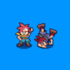|[ThronoCrigger - Scars of Time](https://thronocrigger.bandcamp.com/track/scars-of-time)|
||[ThronoCrigger - Corridors of Time](https://thronocrigger.bandcamp.com/track/corridors-of-time)|
||[ThronoCrigger - Dream of the Shore Near Another World](https://thronocrigger.bandcamp.com/track/dream-of-the-shore-near-another-world)|
||[ThronoCrigger - Schala's Theme](https://thronocrigger.bandcamp.com/track/schalas-theme)|
||[ThronoCrigger - Fields of Time (Homeworld)](https://thronocrigger.bandcamp.com/track/fields-of-time-homeworld)|
||[H-Mister - Catalyst](https://h-mister.bandcamp.com/track/catalyst)|
|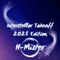|[H-Mister - Interstellar Takeoff 2025 Edition](https://h-mister.bandcamp.com/track/interstellar-takeoff-2025-edition)|
||[H-Mister - Re Entry](https://h-mister.bandcamp.com/track/re-entry)|
||[H-Mister - Tranquility](https://h-mister.bandcamp.com/track/tranquility)|
||[H-Mister - Beyond](https://h-mister.bandcamp.com/track/beyond)|
||[H-Mister - Limitless](https://h-mister.bandcamp.com/track/limitless)|
|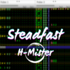|[H-Mister - Steadfast](https://h-mister.bandcamp.com/track/steadfast)|
||[H-Mister - Moving Forward](https://h-mister.bandcamp.com/track/moving-forward)|
|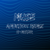|[H-Mister - Muse (Ambition Remix)](https://h-mister.bandcamp.com/track/muse-ambition-remix)|
||[H-Mister - Warp](https://h-mister.bandcamp.com/track/warp)|
||[H-Mister - Neon Flow](https://h-mister.bandcamp.com/track/neon-flow)|
|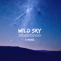|[H-Mister - Wild Sky](https://h-mister.bandcamp.com/track/wild-sky)|
||[H-Mister - Traversal](https://h-mister.bandcamp.com/track/traversal)|
|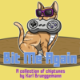|[Karl Brueggemann - Scratch City Shakedown](https://karlbmusic.bandcamp.com/track/scratch-city-shakedown)|
||[Karl Brueggemann - Diving Into the Submerged Relic City](https://karlbmusic.bandcamp.com/track/diving-into-the-submerged-relic-city)|
||[Karl Brueggemann - Crashing the NecroParty](https://karlbmusic.bandcamp.com/track/crashing-the-necroparty)|
||[Karl Brueggemann - Mount Everblue](https://karlbmusic.bandcamp.com/track/mount-everblue)|
||[Karl Brueggemann - Tabby Tower](https://karlbmusic.bandcamp.com/track/tabby-tower)|
||[Karl Brueggemann - Acequia](https://karlbmusic.bandcamp.com/track/acequia-2)|
||[Karl Brueggemann - Dashing Dock Zone](https://karlbmusic.bandcamp.com/track/dashing-dock-zone)|
||[Karl Brueggemann - Forgotten Airbase](https://karlbmusic.bandcamp.com/track/forgotten-airbase)|
||[BE NOT] - [AFRAID]|
||[H-Mister - Violet Cut](https://h-mister.bandcamp.com/track/violet-cut)|
||[H-Mister - Grid](https://h-mister.bandcamp.com/track/grid)|
||[H-Mister - Lose Yourself 2022 Edition](https://h-mister.bandcamp.com/track/lose-yourself-2022-edition)|
||[H-Mister - True Ascension](https://h-mister.bandcamp.com/track/true-ascension)|
||[H-Mister - Ready Set Action! 2021 Edition](https://h-mister.bandcamp.com/track/ready-set-action-2021-edition)|
|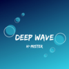|[H-Mister - Deep Wave](https://h-mister.bandcamp.com/track/deep-wave)|
||[ko0x - Essential Facts Of Life](https://soundcloud.com/ko0x/ko0x-essential-facts-of-life)|
|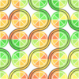|[ThronoCrigger - Ghosting](https://thronocrigger.bandcamp.com/track/ghosting)|
||[ThronoCrigger - The first day of summer (Blueberries)](https://thronocrigger.bandcamp.com/track/the-first-day-of-summer-blueberries)|
||[ThronoCrigger - Likeminded](https://thronocrigger.bandcamp.com/track/likeminded)|
||[ThronoCrigger - Lifelime](https://thronocrigger.bandcamp.com/album/lifelime)|
||[ThronoCrigger - Pistachio](https://thronocrigger.bandcamp.com/track/pistachio)|
||[H-Mister - Delta](https://h-mister.bandcamp.com/track/delta)|
||[Karl Brueggemann - Sunny Again](https://karlbmusic.bandcamp.com/track/sunny-again)|
||[ko0x - What Could Go Wrong](https://ko0x.bandcamp.com/track/what-could-go-wrong)|
||[ko0x - Open End](https://ko0x.bandcamp.com/track/open-end)|
||[ko0x - Rise Of The Cynic](https://ko0x.bandcamp.com/track/rise-of-the-cynic)|
||[ko0x - Cherryjam](https://ko0x.bandcamp.com/track/cherryjam)|
||[ko0x - Texel](https://ko0x.bandcamp.com/track/texel)|
||[ko0x - Running In The Rain](https://ko0x.bandcamp.com/track/running-in-the-rain)|
||[ko0x - Galaxy Guppy](https://ko0x.bandcamp.com/track/galaxy-guppy)|
||[ko0x - Cthulhu Cumulus](https://ko0x.bandcamp.com/track/cthulhu-cumulus)|
|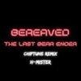|[H-Mister - The Last Bear Ender - Bereaved (Chiptune Remix)](https://h-mister.bandcamp.com/track/the-last-bear-ender-bereaved-chiptune-remix)|
|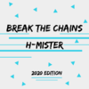|[H-Mister - Break The Chains 2020 Edition](https://h-mister.bandcamp.com/track/break-the-chains-2020-edition)|
||[H-Mister - Focus](https://h-mister.bandcamp.com/track/focus)|
||[H-Mister - Step Up](https://h-mister.bandcamp.com/track/step-up)|
||[ko0x - Every Day Of My Life](https://ko0x.bandcamp.com/track/every-day-of-my-life)|
||[ko0x - Caramel Condition](https://ko0x.bandcamp.com/track/caramel-condition)|
||[ko0x - Dancing In Slow Motion](https://ko0x.bandcamp.com/track/dancing-in-slow-motion)|
|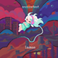|[laamaa - peace](https://laamaa.bandcamp.com/track/peace)|
||[laamaa - rapid eye movement](https://laamaa.bandcamp.com/track/rapid-eye-movement)|
||[laamaa - whispers of fall (ft. muLperi)](https://laamaa.bandcamp.com/track/whispers-of-fall-ft-mulperi)|
||[laamaa - banjoman](https://laamaa.bandcamp.com/track/banjoman)|
||[laamaa - viral orb](https://laamaa.bandcamp.com/track/viral-orb)|
||[laamaa - spacey shoes](https://laamaa.bandcamp.com/track/spacey-shoes)|
||[laamaa - always with me](https://laamaa.bandcamp.com/track/always-with-me)|
||[laamaa - my first sega](https://laamaa.bandcamp.com/track/my-first-sega)|
||[laamaa - november blues](https://laamaa.bandcamp.com/track/november-blues)|
||[laamaa - vs mode](https://laamaa.bandcamp.com/track/vs-mode)|
||[laamaa - may day](https://laamaa.bandcamp.com/track/may-day)|
||[DELTARUNE - Flower Man (nu11's VRC6 cover)](https://nu11.bandcamp.com/track/flower-man-nu11s-vrc6-cover)|
||[H-Mister - Burning](https://h-mister.bandcamp.com/track/burning)|
|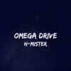|[H-Mister - Omega drive (New mix)](https://h-mister.bandcamp.com/track/omega-drive-new-mix)|
|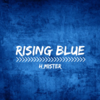|[H-Mister - Alpha](https://h-mister.bandcamp.com/track/alpha)|
||[H-Mister - Destination](https://h-mister.bandcamp.com/track/destination)|
||[H-Mister - Tension](https://h-mister.bandcamp.com/track/tension)|
|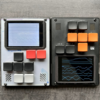|[laamaa - mall of finland](https://laamaa.bandcamp.com/track/mall-of-finland)|
||[laamaa - turenki city lights](https://laamaa.bandcamp.com/track/turenki-city-lights)|
||[laamaa - winter brk](https://laamaa.bandcamp.com/track/winter-brk)|
||[laamaa - snowy day melody](https://laamaa.bandcamp.com/track/snowy-day-melody)|
||[laamaa - rainy day melody](https://laamaa.bandcamp.com/track/rainy-day-melody)|
||[laamaa - omniokra](https://laamaa.bandcamp.com/track/omniokra)|
|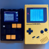|[laamaa - better days](https://laamaa.bandcamp.com/track/better-days-2)|
||[laamaa - summer animals](https://laamaa.bandcamp.com/track/summer-animals)|
||[laamaa - week 9](https://laamaa.bandcamp.com/track/week-9)|
||[laamaa - baby carrier boogie](https://laamaa.bandcamp.com/track/baby-carrier-boogie)|
||[laamaa - stonetooth](https://laamaa.bandcamp.com/track/stonetooth)|
|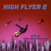|[Karl Brueggemann - Bulkhead](https://karlbmusic.bandcamp.com/track/bulkhead)|
||[Karl Brueggemann - Mind the Gaps, Find the Scraps](https://karlbmusic.bandcamp.com/track/mind-the-gaps-find-the-scraps)|
||[Karl Brueggemann - Saturday in Igloo Town](https://karlbmusic.bandcamp.com/track/mind-the-gaps-find-the-scraps)|
||[Karl Brueggemann - Returning to TechnaTower](https://karlbmusic.bandcamp.com/track/returning-to-technatower)|
||[Karl Brueggemann - On the Fly](https://karlbmusic.bandcamp.com/track/on-the-fly)|
||[Karl Brueggemann - Gunk Squad](https://karlbmusic.bandcamp.com/track/gunk-squad)|
||[Karl Brueggemann - I Feel the Best With You](https://karlbmusic.bandcamp.com/track/i-feel-the-best-with-you)|
|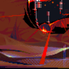|[Rei8bit - Roots of Ruin](https://rei8bit.bandcamp.com/track/roots-of-ruin)|
|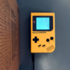|[laamaa - profit](https://laamaa.bandcamp.com/track/profit)|
||[laamaa - loss](https://laamaa.bandcamp.com/track/loss)|
|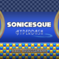|[Karl Brueggemann - Ratchet Yard Zone](https://karlbmusic.bandcamp.com/track/ratchet-yard-zone)|
||[Karl Brueggemann - Flow City Zone](https://karlbmusic.bandcamp.com/track/flow-city-zone)|
||[Karl Brueggemann - Jungle Jam Zone](https://karlbmusic.bandcamp.com/track/jungle-jam-zone)|
||[Karl Brueggemann - Cloud View Zone](https://karlbmusic.bandcamp.com/track/cloud-view-zone)|
||[Karl Brueggemann - Wicked Grotto Zone](https://karlbmusic.bandcamp.com/track/wicked-grotto-zone)|
|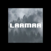|[laamaa - scape](https://laamaa.bandcamp.com/track/scape)|
|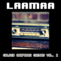|[laamaa - opl omega](https://laamaa.bandcamp.com/track/opl-omega)|
||[laamaa - after dark](https://laamaa.bandcamp.com/track/after-dark)|
||[laamaa - talossa II (edit)](https://laamaa.bandcamp.com/track/talossa-ii-edit)|
||[laamaa - gunshot](https://laamaa.bandcamp.com/track/gunshot)|
||[laamaa - controversy](https://laamaa.bandcamp.com/track/controversy)|
||[laamaa - summer 2001](https://laamaa.bandcamp.com/track/summer-2001)|
||[laamaa - the licc of death](https://laamaa.bandcamp.com/track/the-licc-of-death)|
|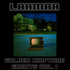|[laamaa - nuri brut](https://laamaa.bandcamp.com/track/nuri-brut)|
||[laamaa - kotimokkula (feat. Dya)](https://laamaa.bandcamp.com/track/kotimokkula-feat-dya)|
||[laamaa - bluesy](https://laamaa.bandcamp.com/track/bluesy)|
||[laamaa - tarinmaa boogie](https://laamaa.bandcamp.com/track/tarinmaa-boogie)|
||[laamaa - nellychi](https://laamaa.bandcamp.com/track/nellychi)|
||[laamaa - hacker weisse](https://laamaa.bandcamp.com/track/hacker-weisse)|
||[laamaa - sunset adventurer](https://laamaa.bandcamp.com/track/sunset-adventurer)|
||[laamaa - fromage overture](https://laamaa.bandcamp.com/track/fromage-overture)|
|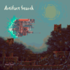|[Rei8bit - Flickering Sanctuary](https://rei8bit.bandcamp.com/track/flickering-sanctuary)|
||[Rei8bit - Uncharted Subterranean](https://rei8bit.bandcamp.com/track/uncharted-subterranean)|
||[Rei8bit - Anorthosite Field](https://rei8bit.bandcamp.com/track/uncharted-subterranean)|
||[Rei8bit - Star Observation](https://rei8bit.bandcamp.com/track/star-observation)|
||[Rei8bit - Collapsar Space](https://rei8bit.bandcamp.com/track/collapsar-space)|
||[Rei8bit - UNS-ID- N-16X](https://rei8bit.bandcamp.com/track/uns-id-n-16x)|
||[Rei8bit - Pulsar Circulation](https://rei8bit.bandcamp.com/track/pulsar-circulation)|
||Rei8bit - Unknown Artifact|
|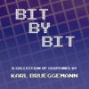|[Karl Brueggemann - Panda Dance](https://karlbmusic.bandcamp.com/track/panda-dance)|
||[Karl Brueggemann - Strolling the Sewer](https://karlbmusic.bandcamp.com/track/strolling-the-sewer)|
||[Karl Brueggemann - Wild Penguin Strike](https://karlbmusic.bandcamp.com/track/wild-penguin-strike)|
||[Karl Brueggemann - Storming the Armory](https://karlbmusic.bandcamp.com/track/storming-the-armory)|
||[Karl Brueggemann - Atop Matera Cliffside](https://karlbmusic.bandcamp.com/track/atop-matera-cliffside)|
||[Karl Brueggemann - Pie in the Sky](https://karlbmusic.bandcamp.com/track/pie-in-the-sky)|
||[Karl Brueggemann - Big Chunk](https://karlbmusic.bandcamp.com/track/big-chunk)|
||[Karl Brueggemann - Waterline Blaster](https://karlbmusic.bandcamp.com/track/waterline-blaster)|
||[Karl Brueggemann - Telemart](https://karlbmusic.bandcamp.com/track/telemart)|
||[Karl Brueggemann - Hypoxia](https://karlbmusic.bandcamp.com/track/hypoxia)|
||[Karl Brueggemann - Infinite Drift](https://karlbmusic.bandcamp.com/track/infinite-drift)|
||[Karl Brueggemann - Chance Meeting](https://karlbmusic.bandcamp.com/track/chance-meeting)|
||[Karl Brueggemann - D Cipher](https://karlbmusic.bandcamp.com/track/d-cipher)|
||[Karl Brueggemann - Micropower](https://karlbmusic.bandcamp.com/track/micropower)|
|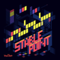|[Rei8bit - Stable Point](https://rei8bit.bandcamp.com/track/stable-point)|
|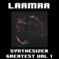|[laamaa - Midsummer](https://laamaa.bandcamp.com/track/midsummer)|
||[laamaa - Signaalinseuraaja](https://laamaa.bandcamp.com/track/signaalinseuraaja-2)|
||[laamaa - Talossa](https://laamaa.bandcamp.com/track/talossa)|
||[laamaa - Guitarsid](https://laamaa.bandcamp.com/track/guitarsid)|
||[laamaa - Tristesse](https://laamaa.bandcamp.com/track/tristesse-2)|
||[Laamaa & Oskill8 - When We Were](https://laamaa.bandcamp.com/track/when-we-were)|
||[Laamaa & Oskill8 - Lamminsahtia](https://laamaa.bandcamp.com/track/lamminsahtia)|
|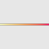|[ThronoCrigger - Leidenfrost](https://thronocrigger.bandcamp.com/track/leidenfrost)|
||[ThronoCrigger - Scattering through clouds](https://thronocrigger.bandcamp.com/track/scattering-through-clouds)|
||[ThronoCrigger - Stratosphere](https://thronocrigger.bandcamp.com/track/stratosphere)|
||[ThronoCrigger - Noisy Nerds](https://thronocrigger.bandcamp.com/track/noisy-nerds)|
||[ThronoCrigger - Whispers](https://thronocrigger.bandcamp.com/track/whispers)|
|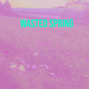|[ThronoCrigger - Breeze](https://thronocrigger.bandcamp.com/track/breeze)|
||[ThronoCrigger - Bloom](https://thronocrigger.bandcamp.com/track/bloom)|
|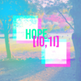|[ThronoCrigger - Spring Fragrances](https://thronocrigger.bandcamp.com/track/spring-fragrances)|
||[ThronoCrigger - Summer Vibes](https://thronocrigger.bandcamp.com/track/summer-vibes)|
|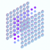|[ThronoCrigger - Icarus](https://thronocrigger.bandcamp.com/track/icarus)|
||[ThronoCrigger - Alraune (ft. Grizzly Cogs)](https://thronocrigger.bandcamp.com/track/alraune-ft-grizzly-cogs)|
||[ThronoCrigger - Simulacra](https://thronocrigger.bandcamp.com/track/simulacra)|
||[ThronoCrigger - Heliolite (ft. hexosphere)](https://thronocrigger.bandcamp.com/track/heliolite-ft-hexosphere)|
||[ThronoCrigger - Gay Crush](https://thronocrigger.bandcamp.com/track/gay-crush-2)|
||[ThronoCrigger - Shining Air](https://thronocrigger.bandcamp.com/track/shining-air)|
||[ThronoCrigger - Starborn (ft. Breakbeat Heartbeat)](https://thronocrigger.bandcamp.com/track/starborn-ft-breakbeat-heartbeat)|
||[ThronoCrigger - Generation Z](https://thronocrigger.bandcamp.com/track/generation-z)|
|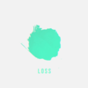|[ThronoCrigger - Raspberry](https://thronocrigger.bandcamp.com/track/raspberry)|
||[ThronoCrigger - Dazzling Gleam](https://thronocrigger.bandcamp.com/track/dazzling-gleam)|
||[ThronoCrigger - Colourful Comets](https://thronocrigger.bandcamp.com/track/colourful-comets)|
||[ThronoCrigger - Fishing the past](https://thronocrigger.bandcamp.com/track/fishing-the-past)|
||[ThronoCrigger - Data Terror](https://thronocrigger.bandcamp.com/track/data-terror)|
||[ThronoCrigger - Muscatel](https://thronocrigger.bandcamp.com/track/muscatel)|
|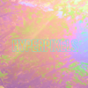|[ThronoCrigger - Pixel Trails](https://thronocrigger.bandcamp.com/track/pixel-trails)|
||[ThronoCrigger - Venturing In The Jungle](https://thronocrigger.bandcamp.com/track/venturing-in-the-jungle)|
||[ThronoCrigger - Voltage](https://thronocrigger.bandcamp.com/track/voltage)|
||[ThronoCrigger - The Quest](https://thronocrigger.bandcamp.com/track/the-quest)|
||[ThronoCrigger - Dalgona Coffee](https://thronocrigger.bandcamp.com/track/dalgona-coffee)|
||[Breakbeat Heartbeat - Delta (Cover by ThronoCrigger)](https://thronocrigger.bandcamp.com/track/delta-cover)|
||[laamaa - ducks 🦆🦆](https://laamaa.bandcamp.com/track/ducks)|
||[laamaa - dogs 🐕🐕](https://laamaa.bandcamp.com/track/dogs)|
|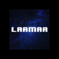|[laamaa - electric blues](https://laamaa.bandcamp.com/track/electric-blues)|
|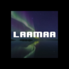|[laamaa - revontuli](https://laamaa.bandcamp.com/track/revontuli)|
||[laamaa - avotuli](https://laamaa.bandcamp.com/track/avotuli)|
|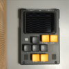|[laamaa - do you remember](https://laamaa.bandcamp.com/track/do-you-remember)|
||[laamaa - trainers](https://laamaa.bandcamp.com/track/trainers)|
||[laamaa - bells](https://laamaa.bandcamp.com/track/bells-2)|
||[laamaa - we never saw berlin](https://laamaa.bandcamp.com/track/we-never-saw-berlin)|
|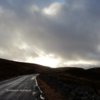|[Breakbeat Heartbeat - I Need You](https://breakbeatheartbeat.bandcamp.com/track/i-need-you)|
||[Breakbeat Heartbeat - Moon Beams](https://breakbeatheartbeat.bandcamp.com/track/moon-beams)|
||[Breakbeat Heartbeat - It's Not The Same](https://breakbeatheartbeat.bandcamp.com/track/its-not-the-same)|
||[Breakbeat Heartbeat - Clouds](https://breakbeatheartbeat.bandcamp.com/track/clouds)|
||[Breakbeat Heartbeat - Rest In Power](https://breakbeatheartbeat.bandcamp.com/track/rest-in-power)|
||[Breakbeat Heartbeat - Vega](https://breakbeatheartbeat.bandcamp.com/track/vega)|
|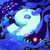|[Omnicorum - Coconut Mist! (feat. rithikcorrupt)](https://omnicorum.bandcamp.com/track/coconut-mist-feat-rithikcorrupt)|
|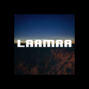|[laamaa - streamers](https://laamaa.bandcamp.com/track/streamers)|
||[laamaa - via bornholm](https://laamaa.bandcamp.com/track/via-bornholm)|
|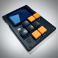|[laamaa - stars be my guide](https://laamaa.bandcamp.com/track/stars-be-my-guide)|
||[laamaa - going home](https://laamaa.bandcamp.com/track/going-home)|
||[laamaa - just once](https://laamaa.bandcamp.com/track/just-once)|
||[laamaa - weeks, months, years](https://laamaa.bandcamp.com/track/weeks-months-years)|
||[laamaa - accordionwave](https://laamaa.bandcamp.com/track/accordionwave)|
|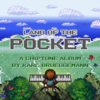|[Karl Brueggemann - It's a Pocket Paradise!](https://karlbmusic.bandcamp.com/track/its-a-pocket-paradise)|
||[Karl Brueggemann - Pocket 1: Jade Shore](https://karlbmusic.bandcamp.com/track/pocket-1-jade-shore)|
||[Karl Brueggemann - Pocket 2: Carmine Offices](https://karlbmusic.bandcamp.com/track/pocket-2-carmine-offices)|
||[Karl Brueggemann - Pocket 3: Smalt Factory](https://karlbmusic.bandcamp.com/track/pocket-3-smalt-factory)|
||[Karl Brueggemann - Pocket 4: Sunshade Slopes](https://karlbmusic.bandcamp.com/track/pocket-4-sunshade-slopes)|
||[Karl Brueggemann - An Arcane Wisdom](https://karlbmusic.bandcamp.com/track/an-arcane-wisdom)|
||[Karl Brueggemann - Pocket 5: Olivine Crest](https://karlbmusic.bandcamp.com/track/pocket-5-olivine-crest)|
||[Karl Brueggemann - Pocket 7: Metallic Tundra](https://karlbmusic.bandcamp.com/track/pocket-7-metallic-tundra)|
||[Omnicorum - To The Moon (w/ rithikcorrupt)](https://omnicorum.bandcamp.com/track/to-the-moon-w-rithikcorrupt)|
|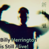|[beat_shobon - Billy Herrington is Still Alive! (2017 Mix)](https://beatshobon.bandcamp.com/album/billy-herrington-is-still-alive-2017-mix)|
|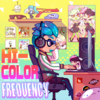|[beat_shobon - Inkopolis Shopping District News](https://beatshobon.bandcamp.com/track/inkopolis-shopping-district-news)|
||[beat_shobon - Get Your Kicks](https://beatshobon.bandcamp.com/track/get-your-kicks)|
||[beat_shobon - Octostep](https://beatshobon.bandcamp.com/track/octostep)|
||[beat_shobon - She Came From Inkopolis](https://beatshobon.bandcamp.com/track/she-came-from-inkopolis)|
||[beat_shobon - we took the tower](https://beatshobon.bandcamp.com/track/we-took-the-tower)|
||[beat_shobon - Rising Tide](https://beatshobon.bandcamp.com/track/rising-tide)|
||[beat_shobon - Shiokara Festival](https://beatshobon.bandcamp.com/track/shiokara-festival)|
||[beat_shobon - A New, Fresh Start](https://beatshobon.bandcamp.com/track/a-new-fresh-start)|
|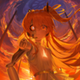|[beat_shobon - Absence of Light (feat. Adachi Rei)](https://beatshobon.bandcamp.com/album/absence-of-light)|
|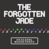|[ThronoCrigger - Beach Theme](https://thronocrigger.bandcamp.com/track/beach-theme)|
||[ThronoCrigger - The Rocks](https://thronocrigger.bandcamp.com/track/the-rocks)|
||[ThronoCrigger - Into the Cave](https://thronocrigger.bandcamp.com/track/into-the-cave)|
||[ThronoCrigger - The Final Boss](https://thronocrigger.bandcamp.com/track/the-final-boss)|
|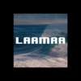|[laamaa - september](https://laamaa.bandcamp.com/track/september)|
||[laamaa - bullet train](https://laamaa.bandcamp.com/track/bullet-train)|
||[laamaa - dolphins 🐬](https://laamaa.bandcamp.com/track/dolphins-2)|
|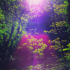|[Breakbeat Heartbeat - Leaving Home](https://breakbeatheartbeat.bandcamp.com/track/leaving-home)|
||[Breakbeat Heartbeat - If I See You Again](https://breakbeatheartbeat.bandcamp.com/track/if-i-see-you-again)|
||[Breakbeat Heartbeat - Grey](https://breakbeatheartbeat.bandcamp.com/track/grey)|
||[Breakbeat Heartbeat - Delta (Remaster)](https://breakbeatheartbeat.bandcamp.com/track/delta-remaster)|
||[Breakbeat Heartbeat - Alone](https://breakbeatheartbeat.bandcamp.com/track/alone)|
||[Breakbeat Heartbeat - Night Theme](https://breakbeatheartbeat.bandcamp.com/track/night-theme)|
||[Breakbeat Heartbeat - Day Theme](https://breakbeatheartbeat.bandcamp.com/track/day-theme)|
||[Breakbeat Heartbeat - From Up Here](https://breakbeatheartbeat.bandcamp.com/track/from-up-here)|
||[Breakbeat Heartbeat - Racing Heart](https://breakbeatheartbeat.bandcamp.com/track/racing-heart)|
|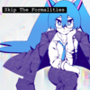|[beat_shobon - Skip The Formalities (feat. Hatsune Miku)](https://beatshobon.bandcamp.com/album/skip-the-formalities)|
|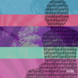|[Breakbeat Heartbeat - Arcade](https://breakbeatheartbeat.bandcamp.com/track/arcade)|
||[Breakbeat Heartbeat - Waterfront](https://breakbeatheartbeat.bandcamp.com/track/waterfront)|
||[Breakbeat Heartbeat - Kids](https://breakbeatheartbeat.bandcamp.com/track/kids)|
||[Breakbeat Heartbeat - Lost & Found](https://breakbeatheartbeat.bandcamp.com/track/lost-found)|
||[Breakbeat Heartbeat - Lamplight](https://breakbeatheartbeat.bandcamp.com/track/lamplight)|
||[Breakbeat Heartbeat - Underground](https://breakbeatheartbeat.bandcamp.com/track/underground)|
||[Breakbeat Heartbeat - Elsa](https://breakbeatheartbeat.bandcamp.com/track/elsa)|
||[beat_shobon - To My Biggest Fan (feat. Kasane Teto)](https://beatshobon.bandcamp.com/album/to-my-biggest-fan)|
|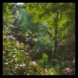|[Breakbeat Heartbeat - You Were My Friend](https://breakbeatheartbeat.bandcamp.com/track/you-were-my-friend)|
||[Breakbeat Heartbeat - Ice Cream](https://breakbeatheartbeat.bandcamp.com/track/ice-cream)|
||[Breakbeat Heartbeat - Constellations](https://breakbeatheartbeat.bandcamp.com/track/constellations)|
||[Breakbeat Heartbeat - Another Night, Another Run](https://breakbeatheartbeat.bandcamp.com/track/another-night-another-run)|
||[Breakbeat Heartbeat - S h i v a](https://breakbeatheartbeat.bandcamp.com/track/s-h-i-v-a)|
|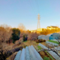|[Rei8bit - Valley for Creative](https://rei8bit.bandcamp.com/track/valley-for-creative)|
||[Rei8bit - there is no phantom](https://rei8bit.bandcamp.com/track/there-is-no-phantom)|
||[Rei8bit - envisions](https://rei8bit.bandcamp.com/track/envisions)|
||[nu11 - Can't Stop Me](https://nu11.bandcamp.com/track/cant-stop-me)|
||[nu11 - Hyper Ultra Overdrive](https://nu11.bandcamp.com/track/hyper-ultra-overdrive)|
||[nu11 - Burning Hot in Freezing Cold](https://nu11.bandcamp.com/track/burning-hot-in-freezing-cold)|
||[nu11 - Tower of Dreams](https://nu11.bandcamp.com/track/tower-of-dreams)|
||[nu11 - Burden of Truth](https://nu11.bandcamp.com/track/burden-of-truth)|
||[nu11 - Fly Away](https://nu11.bandcamp.com/track/fly-away)|
||[nu11 - Running Out of Time](https://nu11.bandcamp.com/track/running-out-of-time-2)|
||[nu11 - Break & Enter](https://nu11.bandcamp.com/track/break-enter)|
||[nu11 - Face Your Destiny](https://nu11.bandcamp.com/track/face-your-destiny)|
||[nu11 - Strike Forward](https://nu11.bandcamp.com/track/strike-forward)|
||[nu11 - Here We Go (Remake)](https://nu11.bandcamp.com/track/here-we-go-remake)|
||[nu11 - Approaching Your Fate (Remake)](https://nu11.bandcamp.com/track/approaching-your-fate-remake)|
||[nu11 - Inner Conflict](https://nu11.bandcamp.com/track/inner-conflict)|
||[nu11 - Melt My Heart](https://nu11.bandcamp.com/track/melt-my-heart)|
||[pilotredsun - greetings](https://pilotredsun.bandcamp.com/track/greetings)|
||[pilotredsun - fat cat](https://pilotredsun.bandcamp.com/track/fat-cat)|
||[pilotredsun - warsaw](https://pilotredsun.bandcamp.com/track/warsaw)|
||[pilotredsun - canals](https://pilotredsun.bandcamp.com/track/canals)|
||[pilotredsun - sadpad](https://pilotredsun.bandcamp.com/track/sadpad)|
||[pilotredsun - 8-train](https://pilotredsun.bandcamp.com/track/8-train)|
||[pilotredsun - bodybuilder](https://pilotredsun.bandcamp.com/track/bodybuilder)|
||[pilotredsun - snow day](https://pilotredsun.bandcamp.com/track/snow-day)|
||[pilotredsun - deathly](https://pilotredsun.bandcamp.com/track/deathly)|
||[pilotredsun - thanks](https://pilotredsun.bandcamp.com/track/thanks)|

